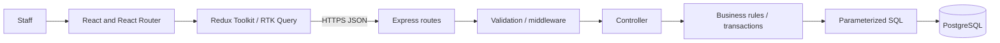
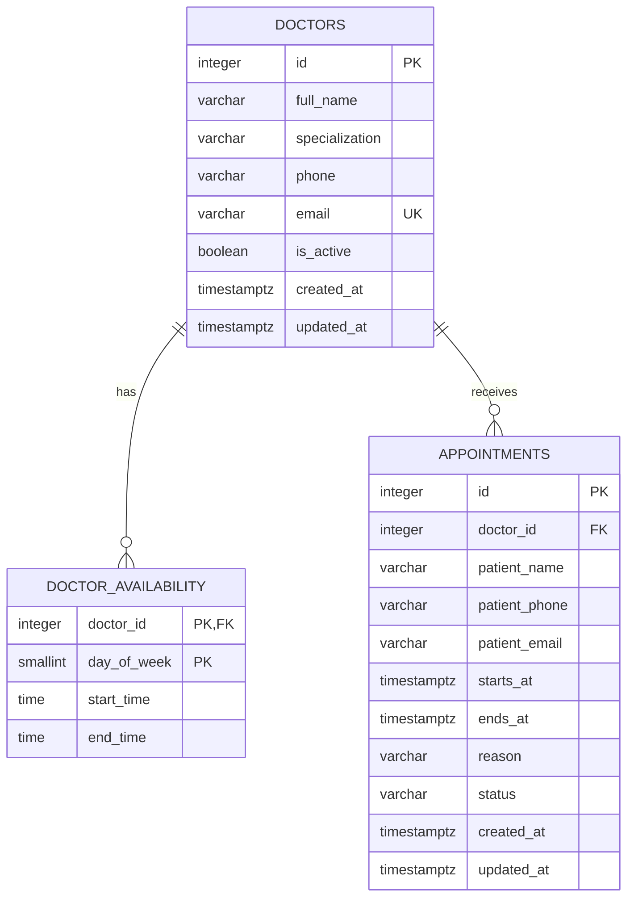

# Dental Clinic Management System — Implementation Plan

## 1. Objective and delivery order

Build a responsive, component-based clinic administration application for an internship assessment. Doctors and appointments must ultimately use a REST API and persist in PostgreSQL. Additional project budget: **$0 / PKR 0**.

The user approved implementation and supplied a medical-site design reference. The latest instruction is to **implement the frontend first, inside `frontend/`**. Save documentation in singular `doc/`. Complete the frontend milestone before creating the backend.

## 2. Repository assessment

Initial repository: `https://github.com/BSSE23102/Dental-Clinic-Management-System`, with only a one-line README. Working tree was clean. `main` and `Develop` pointed to `b87f5ca`; current branch `Develop` tracks `origin/Develop`. The user explicitly accepted the capitalized branch. No applicable AGENTS.md was found.

Local tools: Node 22.12.0, npm 11.13.0, Git 2.39.1, PostgreSQL client 17.4, Python 3.12. PostgreSQL accepts local connections, but database access is not yet verified. Use `npm.cmd` because PowerShell blocks npm.ps1. Git inspection uses a command-scoped safe.directory exception; do not change global configuration.

Project setup and version control were partially complete: repository, remote, branches, and initial commit existed; application scaffolding did not.

## 3. Confirmed requirements and boundaries

| Topic | Decision |
| --- | --- |
| Frontend | React, Vite, JavaScript, React Router, responsive CSS, Lucide React |
| State/API | Redux Toolkit, React Redux, RTK Query; built-in fetchBaseQuery replaces Axios |
| Backend | Node, Express, pg, PostgreSQL, Zod, dotenv, CORS |
| Authentication | Public assessment demo, fictional data only; no fake protected routes |
| Availability | One working interval per weekday per doctor |
| Scheduling | Asia/Karachi; 15–120 minute appointments in 15-minute increments |
| Forms | Accessible dialogs; separate record detail pages |
| Hosting | Render Free frontend, backend, and PostgreSQL; accepted 30-day database expiry |
| Branch | Preserve Develop; do not automatically commit or push |
| Current milestone | Frontend only; explicitly labeled temporary development fixtures are allowed |

Mandatory: dashboard counts, doctor CRUD/search/status/availability, appointment CRUD/search/filter/status changes, overlap prevention, persisted database records, accessible responsive UI, tests, Render deployment, README, PDF, Loom and submission checklist.

Optional and excluded: staff login, patient accounts, billing, prescriptions, reminders, uploads, analytics charts, calendar views, split shifts, holidays, multilingual UI. No premium template, paid component package, AI API, paid image generation, card details, custom domain purchase, or automatic billing.

## 4. Architecture



Frontend services own endpoint definitions. Pages coordinate queries and feature components. RTK Query owns server state; forms own drafts; URL parameters own filters and pagination; a small UI slice owns toasts. No duplicate business-data slices or localStorage database.

Backend layers: routes declare endpoints; middleware validates and handles cross-cutting concerns; controllers handle HTTP; services enforce business rules and transactions; repositories execute parameterized SQL; schemas validate requests/environment; database configuration owns the pool; migration and seed scripts are explicit tools. No ORM, Docker, microservices, or generic framework abstractions.

## 5. Folder structure

```text
frontend/
  src/
    app/             store.js, uiSlice.js
    services/        baseApi.js, doctorsApi.js, appointmentsApi.js, dashboardApi.js
    features/        doctors/, appointments/, dashboard/
    components/      common/, layout/
    pages/
    routes/
    hooks/
    utils/
    styles/
    mocks/           temporary development fixtures; excluded from production
    test/
    App.jsx
    main.jsx
  public/            self-hosted assets and required notices
  package.json, package-lock.json, .env.example
backend/             later milestone
  src/               config/, controllers/, middleware/, repositories/, routes/, schemas/, services/, utils/, app.js, server.js
  db/                migrations/, seeds/, scripts/
  tests/             unit/, integration/
doc/                 plan, design, API, dependencies, testing, deployment, submission
```

## 6. Database model



All columns are non-null unless stated otherwise. Integer record IDs use GENERATED ALWAYS AS IDENTITY. Doctor fields: full_name varchar(120), specialization varchar(100), phone varchar(16), email varchar(254), is_active boolean default true, created_at/updated_at timestamptz default now(). Unique normalized lowercase email; nonblank required text.

Availability: composite primary key (doctor_id, day_of_week); doctor foreign key ON DELETE CASCADE; ISO weekdays 1–7; start/end time without time zone, start before end, quarter-hour boundaries. A separate table is justified by weekly scheduling validation.

Appointments: doctor_id foreign key ON DELETE RESTRICT; patient_name varchar(120), patient_phone varchar(16), nullable patient_email varchar(254), starts_at/ends_at timestamptz, reason varchar(500), status varchar(20) default pending, created/updated timestamps default now(). Check end after start, duration 15–120 minutes in quarter-hour increments, and allowed statuses. Repositories update updated_at explicitly.

Indexes: unique doctor email, appointment (doctor_id, starts_at), appointment (status, starts_at), and the scheduling exclusion constraint. Parameterized ILIKE is sufficient for initial searches. Internal schema_migrations tracks version, checksum, and applied timestamp.

## 7. Scheduling and integrity

- Fixed clinic timezone Asia/Karachi. Database sessions UTC; timestamp values represent instants. Input includes an offset; output is UTC ISO. Browser timezone must not affect scheduling. Centralize conversion and Intl display.
- New and rescheduled appointments start in the future, on quarter hours, and fit entirely into one doctor's working interval on one clinic date. Default duration 30 minutes.
- Active doctors require at least one working day. Inactive doctors cannot receive new/rescheduled bookings. Deactivation keeps existing appointments and their valid status changes.
- Reject availability edits that invalidate pending/confirmed appointments whose end remains in the future.
- Reject doctor deletion if any appointment references it; suggest deactivation.
- Cancellation preserves history and releases the slot. Deletion permanently removes an appointment after confirmation.
- Use btree_gist with a GiST exclusion constraint on doctor ID plus half-open tstzrange [start,end), excluding cancelled rows. Adjacent bookings are allowed; all other statuses reserve their interval.
- Friendly service-level checks supplement the authoritative database constraint. Map overlap violations to 409 APPOINTMENT_CONFLICT.
- Transactions lock affected doctor rows in ascending ID order before appointment rows. Re-read ownership after locking; retry once for concurrent reassignment, otherwise return a conflict.
- Pending → confirmed before start, or cancelled. Confirmed → completed after end, or cancelled. Completed/cancelled are terminal. Repeating the current status is an idempotent success.
- Scheduling edits are available for future pending/confirmed appointments only.

Numbered SQL migrations run transactionally, with checksums and a lock; repeat execution skips applied versions. Explicit seeding creates about 8 doctors and 20 varied appointments relative to execution date. Refuse nonempty tables. Never seed/reset on startup. Production demo seeding requires an explicit flag.

## 8. API contract

See [api-contract.md](api-contract.md) for endpoint-by-endpoint requests, responses, validation, and status codes. Base `/api`; camelCase JSON maps to snake_case SQL. Success `{ data }`; lists include `{ page, limit, total, totalPages }`; error `{ error: { code, message, fieldErrors? } }`. DELETE succeeds with 204 and no body.

Doctors: GET/POST /doctors; GET/PUT/DELETE /doctors/:id. Appointments: GET/POST /appointments; GET/PUT/DELETE /appointments/:id; PATCH /appointments/:id/status. Dashboard: GET /dashboard/stats. Readiness: GET /health.

## 9. Component hierarchy and responsibilities

Provider → Router → AppLayout → Sidebar/Header/Outlet/ToastHost. Routes render dashboard, doctor list/details, appointment list/details, and Not Found.

AppLayout owns shared navigation, global create/edit/delete/status dialogs, selected records, and mutation orchestration. Pages own queries and URL-backed filters. DoctorForm and AppointmentForm own drafts and validation, receive initialValues/onSubmit/onCancel/loading, and keep input after failures. DoctorTable/DoctorDetails/DoctorFilters and corresponding appointment components present domain data and emit actions.

Reusable UI: PageHeader(title, description, actions); Button(variant, loading, disabled); Input/Select(label, value, error, hint); Modal(open/title/onClose/children); ConfirmDialog(description/onConfirm/loading); DataTable(columns/rows/caption/mobileRender); SearchBar(value/onChange); FilterBar; StatusBadge(status); StatCard(label/value/icon); EmptyState(action); LoadingState; ErrorState(message/onRetry); Toast. Add custom hooks only for meaningful reuse, including debounced search and filter handling.

## 10. Pages and design

Routes: `/` redirects to `/dashboard`; `/doctors`, `/doctors/:id`, `/appointments`, `/appointments/:id`, and catch-all Not Found share one layout. No authentication or pretend protection.

Dashboard: real total doctor count, today's noncancelled appointments, upcoming pending/confirmed appointments, all pending appointments, next five upcoming visits, and create actions. Queries use one captured server time and consistent database snapshot.

Doctor list: name/specialization search, active filter, pagination, add/edit/delete and details. Appointment list: patient search, doctor/date/status filters, pagination, add/edit/delete, details, valid status transitions. Detail pages show all required fields and actions.

Adapt the supplied reference's dusty blue hero, white content surfaces, navy text, spacious editorial typography, medical imagery, and restrained borders to a practical dashboard. Keep desktop sidebar and mobile navigation. See [design-system.md](design-system.md).

Use UI/UX Pro Max for primary design planning, Anthropic Frontend Design for implementation guidance, Impeccable for audit/refinement, and Vercel skills for accessibility/React practices. Use free locally hosted Public Sans and Lucide icons. No paid template, component library, or generated image.

Responsive acceptance: 360, 390, 768, 1024, 1440px. Desktop sidebar/full tables, tablet collapsed navigation/two-column summary, mobile drawer/record cards/stacked forms. Semantic controls, labels, focus indicators, skip link, named dialogs, focus return, live feedback, reduced motion, text-based badges, and 44px interaction targets.

## 11. Frontend data flow

One baseApi slice; domain files inject endpoints. Cache tags Doctor, Appointment, Dashboard. Doctor mutations invalidate doctor data, appointment representations, and dashboard; appointment mutations invalidate appointments and dashboard. Refetch on focus/reconnection; avoid polling and automatic write retries. Support cold-start timeouts and clear recovery messages. Doctor selection retrieves all paginated records, avoiding a silent 100-record cutoff.

For frontend-first visual verification only, `?preview=1` opts into labeled development-only in-memory fixtures. Fixtures are not PostgreSQL persistence, reset on refresh, and must not appear in production bundles. Normal mode always uses VITE_API_URL. Production requires the later API milestone.

## 12. Validation and errors

Names: trimmed 2–120 characters; specialization 2–100; email valid and ≤254; patient email optional/null; normalized phones optional leading + and 7–15 digits; reason 2–500; IDs positive integers; unique weekdays and valid increasing hours; allowed statuses; offset-bearing future timestamp; search ≤100; page/limit positive, limit ≤100.

Frontend validation helps users; authoritative backend validation enforces the same constraints plus scheduling/relationships. Backend uses centralized error handling. 400 invalid input/reference, 404 missing target, 409 duplicate/conflict/forbidden transition, 503 unavailable database, 500 unexpected failure. Do not expose SQL, stack traces, or credentials. Forms retain drafts and focus invalid input. Support loading, background refresh, empty, and failure states.

## 13. Security

Fictional records only: public visitors can edit this demo. CORS and frontend routes are not authentication. Parameterized SQL; strict input; 32KB JSON limit; Helmet; exact frontend-origin CORS; no credentialed requests; initial rate limits 120 API requests/minute/IP and 30 writes/minute/IP; correct reverse-proxy configuration. Bound pool size/timeouts, sanitize logs/responses, shut down gracefully. Never put secrets in frontend variables, collection exports, screenshots, or Git.

## 14. Roadmap (frontend-first execution)

| Original phase | Objective / main artifacts | Dependency / verification / acceptance | Effort | Suggested commit |
| --- | --- | --- | --- | --- |
| P0 | Inspect repository, branches, environment | Complete; clean initial tree | 1h | No commit |
| P1 | Reviewed manifests, lockfiles, env examples, ignore rules, design context | Approval; install/lint/build compatible; no secrets | 3–4h | chore: scaffold frontend and backend |
| P7 | React layout, routing, reusable UI, store, base API | P1; keyboard navigation and build | 5–6h | feat(ui): add application shell routing and shared components |
| P8 | Doctor list/detail/forms and RTK integration | P7; frontend tests and temporary preview workflows; API verification deferred | 5–6h | feat(doctors): add doctor management interface |
| P9 | Appointment list/detail/forms/filter/status integration | P7–8; frontend tests and conflict feedback | 6–8h | feat(appointments): add appointment management interface |
| P10 frontend | Dashboard and statistics UI | P7–9; loading/empty/error and cache refresh | 2–3h | feat(dashboard): add clinic overview interface |
| P11 frontend | Responsive/accessibility/design review | Frontend screens complete; required viewports and keyboard checks | 4–6h | fix(ui): improve accessibility and responsive behavior |
| P2 | PostgreSQL tables, constraints, migrations and seeds | Backend milestone; migration repeatability and DB constraints | 5–6h | feat(db): add schema migrations and demo seeds |
| P3 | Express config, pool, middleware, health/errors | P2; sanitized health 200/503 | 3–4h | feat(api): add server foundation and health checks |
| P4 | Doctor API layers | P3; doctor integration suite | 4–5h | feat(doctors): implement doctor REST endpoints |
| P5 | Appointment API, transactions and scheduling | P4; conflicts/adjacency/concurrent requests | 7–9h | feat(appointments): implement scheduling and status rules |
| P6 | Backend validation/integration tests | P4–5; isolated PostgreSQL tests | 4–6h | test(api): cover CRUD validation and concurrency |
| P10 backend | Persisted dashboard queries | P5; fixture-based exact counts | 1–2h | feat(dashboard): add persisted statistics |
| P12 | End-to-end integration QA and defects | Frontend + backend; all acceptance cases | 5–6h | test: verify complete clinic workflows |
| P13 | Render Free provisioning/configuration | P12 and deployment authorization; health/deep links/CRUD/persistence | 3–4h | chore(deploy): configure Render deployment |
| P14 | README, real screenshots/PDF/Loom/Drive package | P13; actual evidence and links verified | 4–6h | docs: complete assessment documentation |

Commands: `npm.cmd --prefix frontend run lint`, `npm.cmd --prefix frontend test`, `npm.cmd --prefix frontend run build`; later backend scripts db:migrate, db:seed, db:verify, test:unit, test:integration, lint and start. Suggested commits do not authorize commits or pushes. Original estimate roughly 62–81 focused hours plus feedback/account setup.

## 15. Testing

T1 validation: required fields, normalization, limits, invalid IDs/dates/statuses. T2 doctor CRUD/filter/availability/duplicate email/restricted deletion. T3 appointment CRUD/filter/reference/inactive doctor/transitions. T4 scheduling boundaries, same/different doctor overlap, adjacent/cancelled slots, durations. T5 real concurrent conflicting bookings and reassignment/availability races. T6 clinic midnight, browser timezone independence, exact dashboard counts. T7 frontend validation, pending submits, retained drafts, confirmations, error/loading/empty states, cache invalidation. T8 migrations, rollback/repeat, seed guards, refresh/restart persistence. T9 manual responsive/keyboard/routes/filters. T10 deployed API/CORS/deep links/health/restarts/secrets/cold startup.

Use Vitest, Supertest, Testing Library and a real isolated PostgreSQL test database for backend integration. Reject destructive test setup unless database name ends `_test` and differs from application DB. Postman collection folders: health, doctors, appointments, dashboard, negatives; sanitized environment variables baseUrl and created IDs. No production records touched by tests.

## 16. Deployment and cost controls

Render Free Static Site + Free Web Service + Free PostgreSQL, selected by user after discussion. Database: PostgreSQL 17, 1GB, same region as backend, expires after 30 days, no managed backups. Web service sleeps after 15 idle minutes, may take about a minute to wake, and shares 750 monthly free instance hours. Published Hobby allowances reviewed during planning: 5GB bandwidth and 500 pipeline minutes. Recheck before provisioning.

Backend root backend, build `npm ci --omit=dev`, start `npm start`, bind 0.0.0.0 and platform PORT, health /api/health. Frontend root frontend, build `npm ci && npm run build`, output dist, rewrite /* → /index.html. Deploy approved Develop revision; initially disable automatic deployment.

Variables: backend-only DATABASE_URL/internal URL, CORS_ORIGIN/exact frontend origin, NODE_ENV=production, platform PORT, DEMO_MODE=true. Local TEST_DATABASE_URL is never production. Frontend VITE_API_URL is public deployed API URL including /api. Pin a compatible Node version.

Provision the database only when submission build is ready. Run migrations and guarded seeding explicitly from the local machine using an external TLS connection because free services lack shell/one-off jobs. Deploy API and UI, verify T10, record real URLs/creation/expiry. pg_dump after verification and before expiry; verify local restoration. No managed backup or indefinite persistence claim.

No payment method, paid plan, autoscaling, paid hook, or purchased domain. Without a payment method, limits can suspend services/builds. If account verification demands a card, report that conflict without enabling billing or silently changing providers.

Sources: https://render.com/docs/free ; https://render.com/pricing ; https://render.com/docs/build-pipeline ; https://render.com/docs/postgresql-extensions ; https://render.com/docs/redirects-rewrites .

## 17. Git workflow

Develop remains the implementation branch; main remains stable. Optional feature branches merge back to Develop. Keep changes small; inspect diffs/checks before proposing commits. No automatic commit, push, branch rename, or merge. Final PR to main only if requested. Ignore env secrets, node_modules, dist, coverage, local dumps, and skill caches; track lockfiles, examples and notices.

## 18. Documentation deliverables

README: overview, features, public-demo boundary, stack, architecture, folders, installation, variables, DB setup, migration/seed/test commands, API, licenses/costs, actual deployment URLs and known limits.

Final PDF: cover; objectives; architecture; ER/schema; stack and cost assessment; real UI screenshots; API; actual tests; deployment; limitations; clickable GitHub, frontend, backend and Loom links. Render and visually inspect before delivery. Never fabricate evidence or results.

## 19. Walkthrough and submission

Loom Starter: use a concise ≤5-minute recording within the published free allowance; no upgrade/trial dependency. Recheck current limits before recording. Suggested timing: 0:00–0:30 overview/navigation; 0:30–1:20 doctor CRUD; 1:20–2:45 appointment CRUD/status/conflict; 2:45–3:30 responsive/loading/empty/error; 3:30–4:15 persistence/live deployment/health; 4:15–4:50 GitHub Develop/architecture/tests. Add short labeled supplementary recordings if needed.

Drive checklist: final PDF and clickable links; sanitized collection; source archive only if required and excluding secrets/caches; functional GitHub/UI/API/health/Loom links; assessor sharing permissions; evidence matches revision; documented DB expiry; private local backup; required submission naming. Upload/sharing/recording/submission require a later user request.

## 20. Traceability and acceptance

| Requirement | Phases | Evidence |
| --- | --- | --- |
| Repo/branch | P0–1 | Clean status, Develop, configured remote |
| PostgreSQL | P2 | T8 |
| REST/error contract | P3–5, P10 | T1–3 |
| Doctors | P4, P8 | T2, T9 |
| Appointments/status | P5, P9 | T3, T9 |
| Overlap/concurrency | P2, P5–6 | T4–5 |
| Timezone/dashboard | P5, P9–10 | T6–7 |
| Requested frontend/RTK | P7–10 | T7, review |
| Accessibility/responsive | P7, P11 | Skill audit and T9 |
| Zero cost/licenses | P1, P11, P14 | Dependency ledger/notices/billing checks |
| Render | P13 | T10 |
| Submission | P14 | Real artifact/link checklist |

Full assessment completion requires persisted API workflows, concurrency-safe bookings, verified deployment and real evidence. Frontend milestone completion means buildable, tested UI with REST integration and clearly separated temporary previews. It does not claim PostgreSQL persistence or deployment before those later phases.
